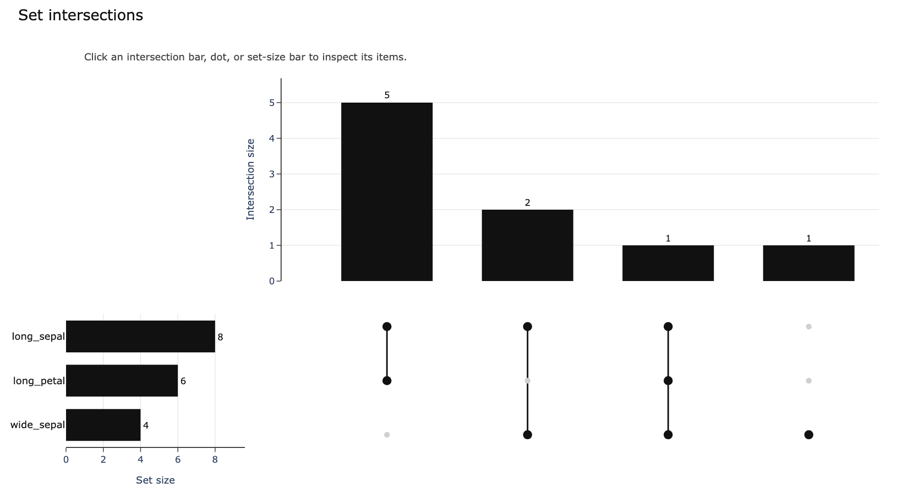

# Dash Plotly UpSet

Interactive set-intersection plots for Plotly and Dash. Plot exclusive
intersections, inspect set sizes, and use clicked bars or matrix dots to select
the original rows for downstream charts and tables.



## Install

Requires Python 3.10 or newer.

```bash
python -m pip install "git+https://github.com/mmmddd98/dash-plotly-upset.git"
```

For Dash applications, install `dash` in the same environment.

## Quick start

```python
from dash_plotly_upset import demo_items, make_upset_figure

items = demo_items()
sets = ["long_sepal", "wide_sepal", "long_petal"]
fig = make_upset_figure(items, sets, min_size=1, top_n=20)
fig.show()
```

Supply a pandas DataFrame or records with one row per item and boolean-like
set columns. Intersections are exclusive: each pattern describes membership
in exactly those sets. `selected_items` retrieves rows for a clicked set or
intersection; `parse_click_data` decodes Dash `clickData`.

## Dash examples

From a source checkout:

```bash
git clone https://github.com/mmmddd98/dash-plotly-upset.git
cd dash-plotly-upset
python -m pip install -e '.[dash,dev]'
python examples/basic_dash_app.py
```

`examples/clientside_dash_app.py` builds figures in the browser using bundled
JavaScript. See the [integration guide and API](docs/usage.md) for both styles,
selection callbacks and multiple highlights.

## Development

```bash
python -m pytest
```

The preview uses the bundled demonstration data. Regenerate it with
`python docs/generate_preview.py` after installing `kaleido` and a compatible
Chrome/Chromium browser.
